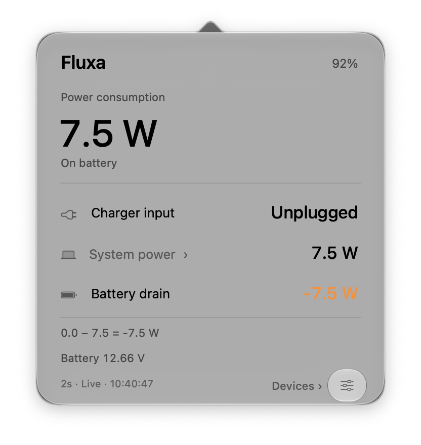
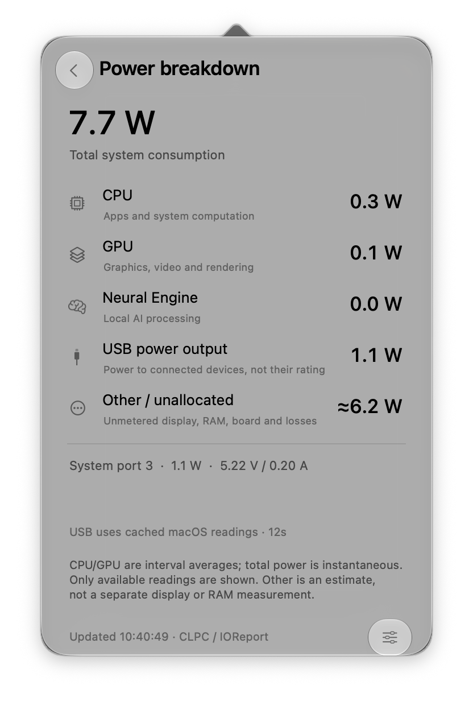

<p align="center"></p>
<h1 align="center">Fluxa</h1>
<p align="center">Power, quietly in view.</p>
<p align="center"><a href="https://github.com/Young-Gl/Fluxa-Mac/releases/latest">Download for Mac</a> · English · <a href="README.zh-CN.md">简体中文</a></p>

Fluxa puts live power in the menu bar and device batteries on your desktop. Click the wattage to see charger input, system consumption and the power going into—or out of—your battery. Feedback and suggestions are welcome at yanghanchao2002@outlook.com.

<p align="center"> </p>

### A closer look at power

- **On external power:** actual input watts, rather than the charger's advertised rating.
- **On battery:** the watts your Mac is consuming.
- **Net charging:** input minus consumption. Negative means the battery is supplying power.
- **Component detail:** available CPU, GPU, Neural Engine and USB output readings. Unavailable values are hidden; estimates are marked.

### Your devices, together

View batteries for trusted iPhone / iPad connections, Apple Watch through its paired iPhone, and connected Bluetooth accessories. AirPods can show separate earbud and case readings when macOS provides them.

Add Fluxa from macOS **Edit Widgets**. Small and medium widgets show up to four batteries; large widgets show up to eight. Choose devices in settings, or let Fluxa choose automatically.

<p align="center"></p>

### Built to stay quiet

Native macOS materials, Liquid Glass on supported systems, and automatic Chinese / English. No account, advertising, analytics or battery alerts. Device readings remain local; existing USB / Wi-Fi trust connections are used to query your devices.

Mac power refreshes every two seconds by default; other devices are polled once a minute. One bounded worker, a small cache, and sampling that pauses during sleep. Widget timing and Bluetooth reporting are controlled by macOS.

### Install

1. Download the DMG from [Releases](https://github.com/Young-Gl/Fluxa-Mac/releases/latest).
2. Drag **Fluxa.app** into **Applications**, then open it.
3. Right-click the desktop → **Edit Widgets** → search **Fluxa**.

Apple silicon MacBook, macOS **13+**. Desktop widgets need **14+**; Liquid Glass needs **26+**. Tested on an M4 MacBook running macOS 27; other models may expose different sensors.

The current download is ad hoc signed and **not notarized**. If macOS blocks it, follow [Apple's opening instructions](https://support.apple.com/en-us/102445), or build from source. Release checksums are included.

First trust your Mac over USB for iPhone / iPad. Wi-Fi readings work when an already trusted device is discoverable. Fluxa does not pair devices or enable wireless syncing. Disconnected readings turn grey and expire after an hour. USB and Bluetooth values may be cached; widgets are a battery overview, not a second-by-second power display.

### Build

AppKit, SwiftUI and WidgetKit; no Swift package dependencies. Current source requires Xcode with the macOS 27 SDK and Python 3.

```sh
./build.command
./test.command
./package.command
```

The app is built and signed in a local cache; `package.command` produces `Fluxa.dmg`. Device libraries are rebuilt for macOS 13. See [runtime rebuilding](Tools/rebuild-runtime.md).

### License and credits

Fluxa's own code and icon use [MIT](LICENSE). Third-party libraries retain their licenses; corresponding LGPL sources, the read-only handshake patch and rebuild instructions are included. See [third-party notices](THIRD_PARTY_NOTICES.md).

[macmon](https://github.com/vladkens/macmon) informed macOS 27 energy-counter support. [AirBattery](https://github.com/lihaoyun6/AirBattery) was a feature and data-channel reference; its application code, icons and executables are not included.

Fluxa is independent. Apple product names identify supported devices and do not imply endorsement. [Privacy](docs/PRIVACY.md) · [Validation](docs/VALIDATION.md) · [Publication notes](docs/LEGAL.md) · [About Fluxa](docs/images/about-en.png)
