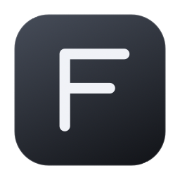
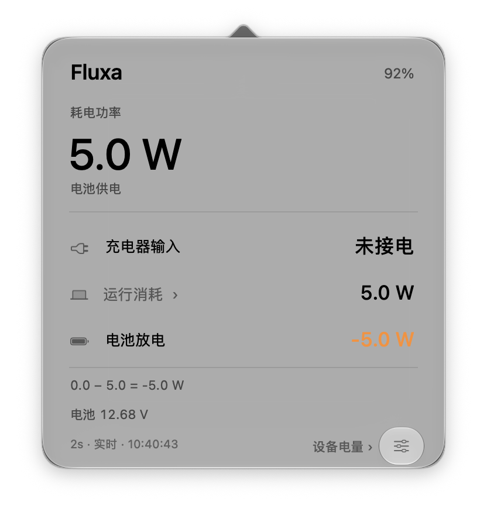
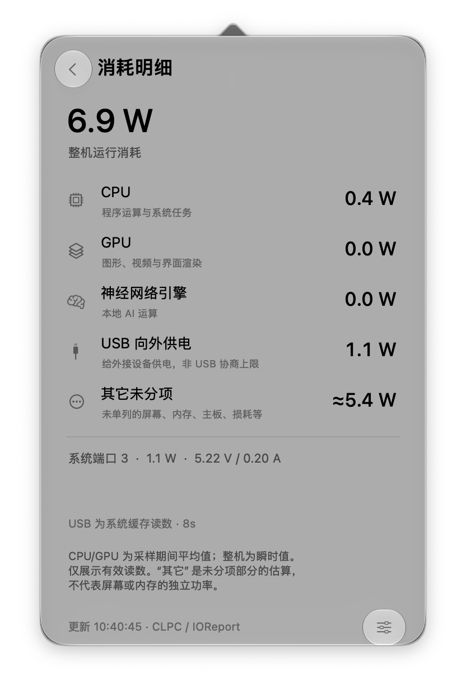
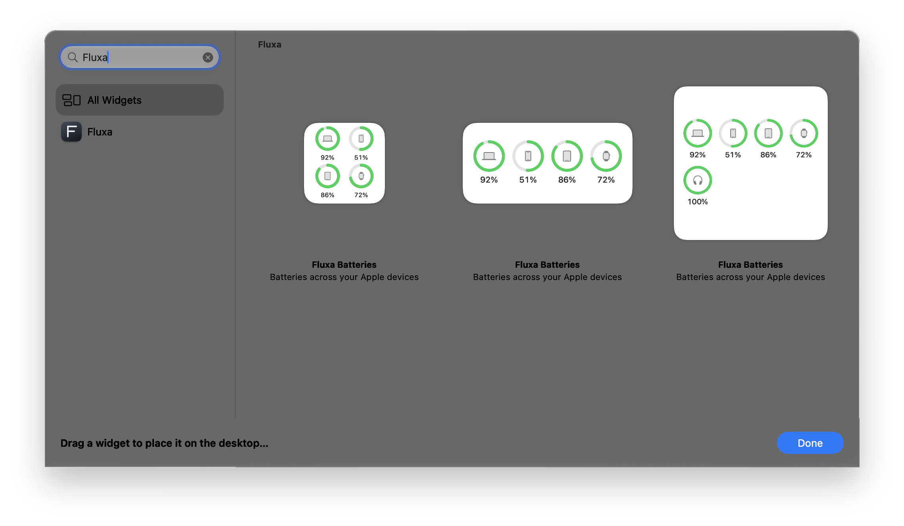

<p align="center"></p>
<h1 align="center">Fluxa</h1>
<p align="center">功率与电量，安静呈现。</p>
<p align="center"><a href="https://github.com/Young-Gl/Fluxa-Mac/releases/latest">下载 Mac 版本</a> · <a href="README.md">English</a> · 简体中文</p>

Fluxa 是一款原生 Mac 功率与电量工具。菜单栏显示实时瓦数，点开查看充电器输入、整机消耗和电池净充电；桌面小组件把常用设备的电量放在一起。反馈与建议可发送至 yanghanchao2002@outlook.com。

<p align="center"> </p>

### 看清功率

- **接电时：** 实际进入 Mac 的功率，而非充电器标称瓦数。
- **电池供电时：** Mac 的运行消耗。
- **净充电：** 输入减去消耗；负数表示电池放电。
- **运行明细：** 硬件提供的 CPU、GPU、神经网络引擎和 USB 向外供电等读数。缺失项目自动隐藏，估算值会注明。

### 把设备电量放在一起

通过已有信任连接读取 iPhone、iPad 电量，经配对的 iPhone 读取 Apple Watch，并展示已连接蓝牙配件的电量。系统提供有效读数时，AirPods 可分别显示左右耳和充电盒。

在 macOS **编辑小组件**中搜索 **Fluxa** 即可添加。小、中尺寸最多四项，大尺寸最多八项；设置中可自行选择设备，也可交给 Fluxa 自动选择。

<p align="center"></p>

### 日常使用，安静一点

原生 macOS 材质，在支持的系统上使用液态玻璃，中英文自动适配。无需注册，不含广告、统计追踪或电量通知。读数保存在本机，设备电量通过已有 USB / Wi-Fi 信任连接查询。

Mac 功率默认每两秒读取，其他设备每分钟读取。任务设有并发和超时限制，只覆盖一个小型缓存；睡眠时暂停。小组件刷新及蓝牙电量上报节奏由 macOS 决定。

### 安装

1. 从 [Releases](https://github.com/Young-Gl/Fluxa-Mac/releases/latest) 下载 DMG。
2. 将 **Fluxa.app** 拖入**应用程序**，打开即可。
3. 右键桌面 → **编辑小组件** → 搜索 **Fluxa**，选择尺寸并添加。

适用于 Apple 芯片 MacBook，macOS **13+**。桌面小组件需要 **14+**，液态玻璃需要 **26+**。已在 M4 MacBook / macOS 27 上实测，其他机型的可用传感器可能不同。

当前包使用本地签名，**尚未经过 Apple 公证**。若系统阻止打开，可按 [Apple 官方说明](https://support.apple.com/zh-cn/102445)处理，或自行从源码构建。发布页提供文件校验值。

iPhone / iPad 首次使用需通过 USB 信任此 Mac；系统能发现已信任设备时可通过 Wi-Fi 读取。Fluxa 不会代为配对或启用无线同步。断连读数变灰，一小时后移除。USB 和蓝牙数据可能来自系统缓存；小组件适合随手查看电量，不用于逐秒观察功率。

### 构建

使用 AppKit、SwiftUI 和 WidgetKit，无 Swift 包依赖。当前源码需要带 macOS 27 SDK 的 Xcode，以及 Python 3。

```sh
./build.command
./test.command
./package.command
```

应用在本地缓存目录构建和签名，`package.command` 生成 `Fluxa.dmg`。设备读取库由源码构建，最低部署版本为 macOS 13；详见[依赖构建说明](Tools/rebuild-runtime.md)。

### 许可与致谢

Fluxa 自有代码及图标采用 [MIT 许可](LICENSE)。第三方依赖保留原有许可，包内附 LGPL 对应源码、禁止自动配对的补丁及重建说明，详见[第三方声明](THIRD_PARTY_NOTICES.md)。

[macmon](https://github.com/vladkens/macmon)为 macOS 27 能耗计数器支持提供了参考。[AirBattery](https://github.com/lihaoyun6/AirBattery)是设备电量功能与数据通道的研究参考，未将其应用源码、图标或程序并入 Fluxa。

Fluxa 是独立项目，Apple 产品名称仅用于说明支持的设备，不表示官方认可。[隐私说明](docs/PRIVACY.md) · [验证记录](docs/VALIDATION.md) · [公开发布说明](docs/LEGAL.md) · [关于 Fluxa](docs/images/about-zh.png)
